# VESSEY: Before the Ice

A 2D side-view zombie barricade shooter in the spirit of the *Last Stand* flash games, wrapped in a light RimWorld-style survivor sim and a storyteller AI that generates stories you remember.

Vessey is a dying paper-mill town on the St. Aubin River, in November. The Guard has sealed the bridge. The river freezes on Nov 28, and then the dead can walk across. Hold a house on Ferry Road with whoever you can find.

**Play:** https://cktang88.github.io/zombies-game/ (built from `main` by `.github/workflows/pages.yml` and published to the `gh-pages` branch)

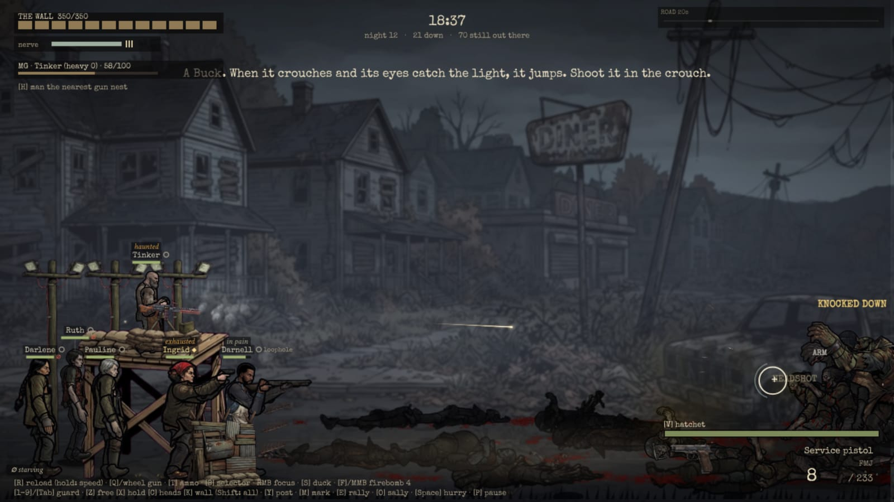

## What's in it
- **The wall at night.** Mouse aim with a true-spread crosshair, head and weak-spot hits, piercing rifles, shell-by-shell shotgun reloads, tactical / speed / smart reloads, jams you clear with a tap-rack or a strip, Focus on the right mouse button, and nerve that runs out. Survivors shoot from the wall with their own skill, wounds and mood; you give them orders and posts, and they can panic, rage, go down and be hauled back.
- **Before the night.** Lay trap kits on a dusk planner (bear traps, propane, deadfalls, lures, pipe mines…) and crew the gun nests: MG nest, swivel rifle, flame projector, nail turret.
- **The Turned.** Shamblers, Deer that sprint, Pulpers that burst, Criers that keen for the others, Ferrymen you knock flat, Bucks that clear the wall, Bilers that spit over it (duck), Drags, tunnellers out of the storm drain, County raiders who shoot back from cover, and the Bellwether on the Crossing.
- **Rigged animation.** Every survivor and Turned is a cutout bone rig: they aim where they shoot, reload stage by stage (each stage voiced), walk from their real ground speed, swing hatchets, duck, crew, fall as Verlet ragdolls from the killing hit and are baked into the road. A Classic single-image mode is one click away (and kicks in by itself on slow machines).
- **Daylight runs.** A side-scrolling walk you play yourself, with one companion if you like. Search doors, cars, sheds and the dead; don't wake the Sleepers; get home before dusk. You may find survivors, guns, papers, and Kin sitting at their kitchen tables.
- **Survivor sim.** Backstories, 24 traits, skills and XP, weapon proficiency, courage and grit, mood built from named thoughts, mental breaks and resolve, wounds by body part, bites and amputations, relationships, earned titles, deaths that ripple through everyone.
- **Storyteller.** Three personas (The Long Siege, The Quiet, The Coin), threat budgets and tides on a calendar, mercy after deaths, 51 incidents, radio threads with deadlines, four factions with standing, and the Crossing on Nov 28.
- **Production.** Workbench, forge, cold frames, infirmary, still, generator and radio; ammunition by caliber and bullet type, 23 guns, 14 attachments in 6 slots, traps, armour, wall reinforcements, and named veteran guns.
- **Endings and legacy.** Three endings (the ferry, the mill, Spring) and a score card; inscribe survivors in a Ledger that lasts across runs and unlock boons. Daily seed for everyone.
- **Sound.** Layered procedural guns plus CC0 recordings, reloads voiced by the animation, ambience beds per scene, procedural music.

## Screenshots

| | |
|---|---|
| 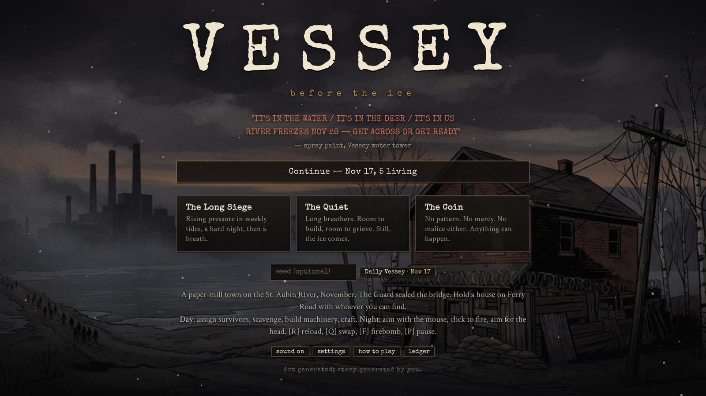 | 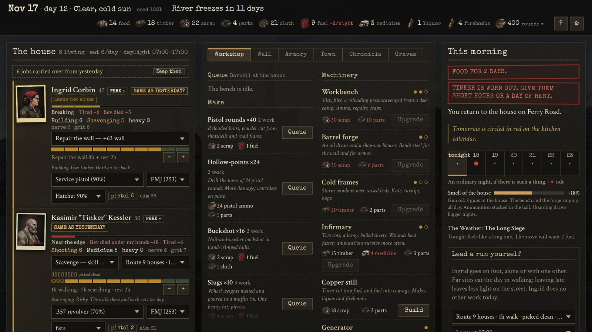 |
| **Title.** Three Weathers, a seed field and the Daily Vessey. | **The day ledger.** Jobs and hours for everyone, the workshop and machinery, the tide calendar and a radio thread's deadline. |
| 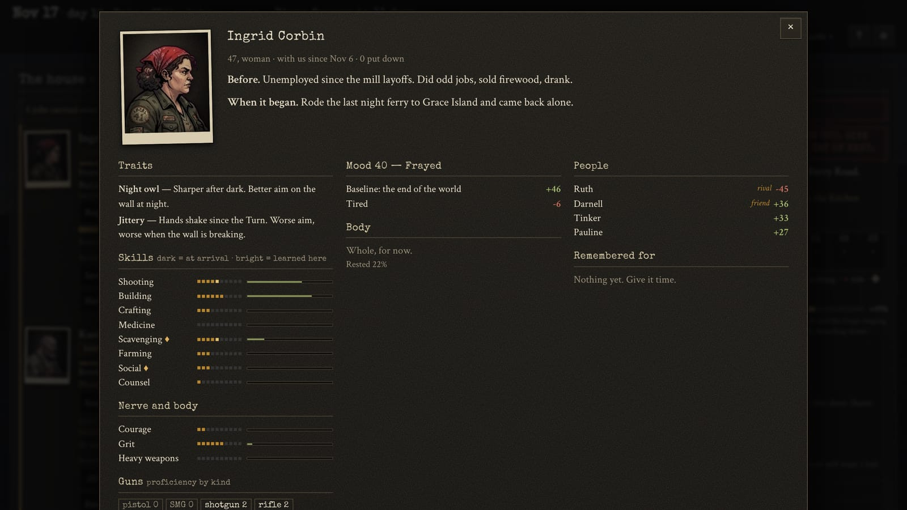 | 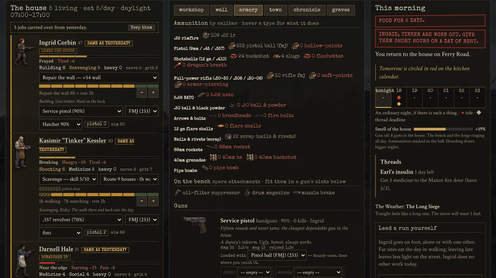 |
| **A survivor.** Traits, skills learned here, courage and grit, gun proficiency, mood lines, the people they love and hate. | **The armory.** Ammunition by caliber and type, spare attachments on the bench, guns with their slots. |
| 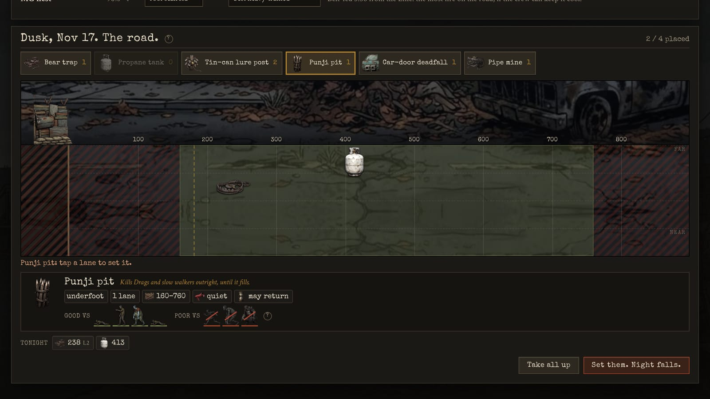 | 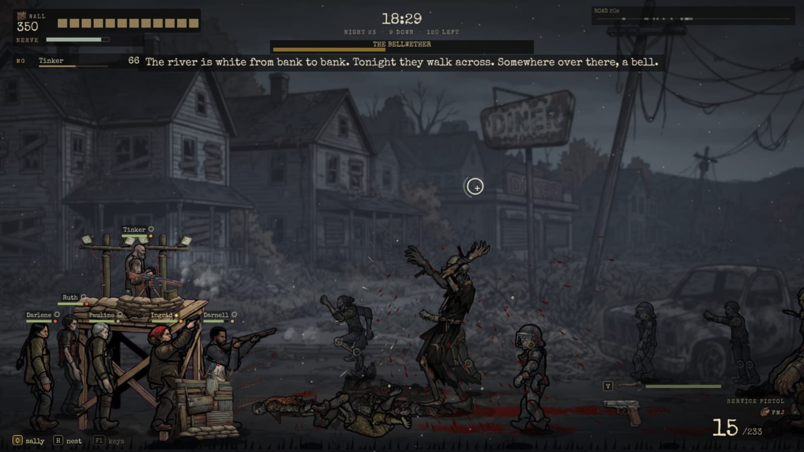 |
| **Dusk.** Posts for the guards, a crew for the MG nest, trap kits on the road. | **The Crossing.** Night 23: the Bellwether carries the bell over the ice. |
| 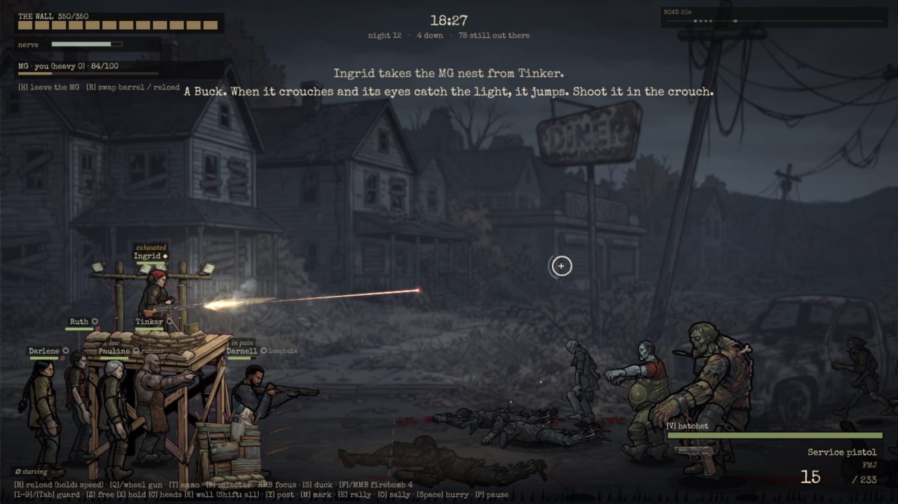 | 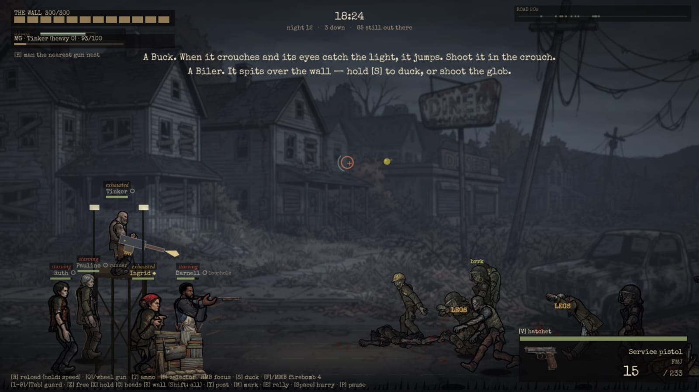 |
| **The MG nest, manned.** [H] takes it; a Buck clears the wall into the line. | **A Biler's glob in the air.** Hold [S] and the leader ducks under the parapet. |
| 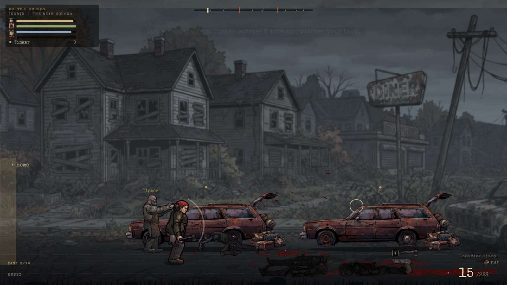 | 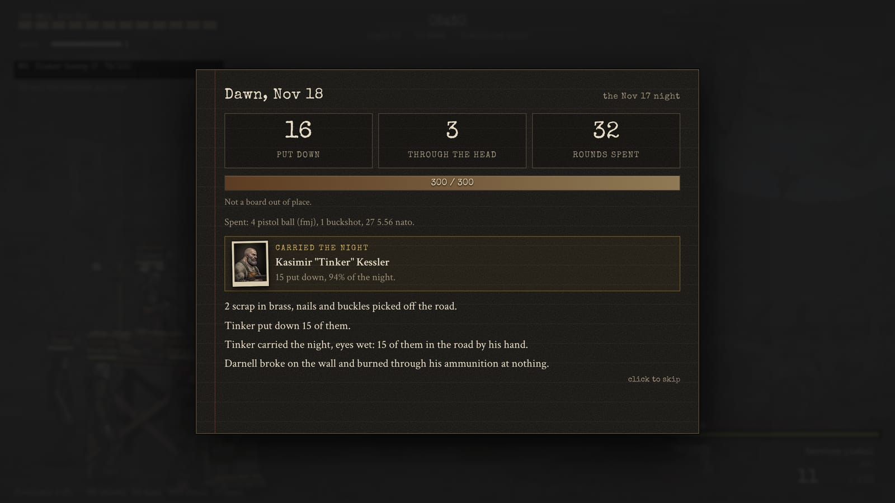 |
| **A daylight run** with Tinker along; the hatchet comes out for one that got close. | **Dawn.** The night's ledger: who carried it, what it cost, what was said. |
| 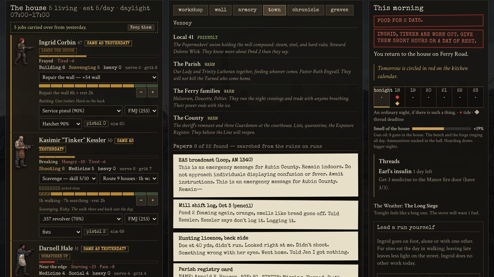 | 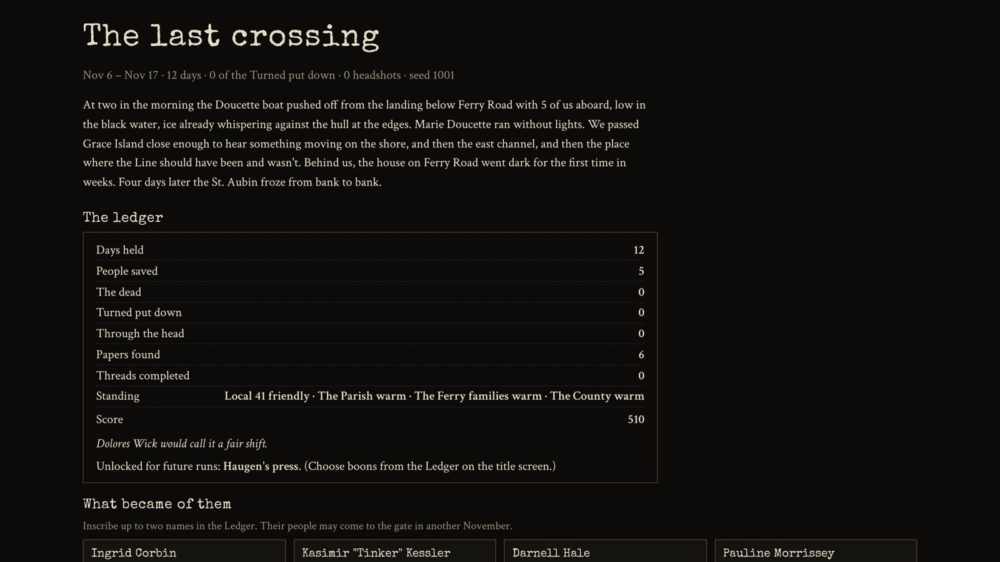 |
| **Town.** Four factions and the papers found on runs. | **An ending.** The last ferry, the score card, and names for the Ledger. |
| 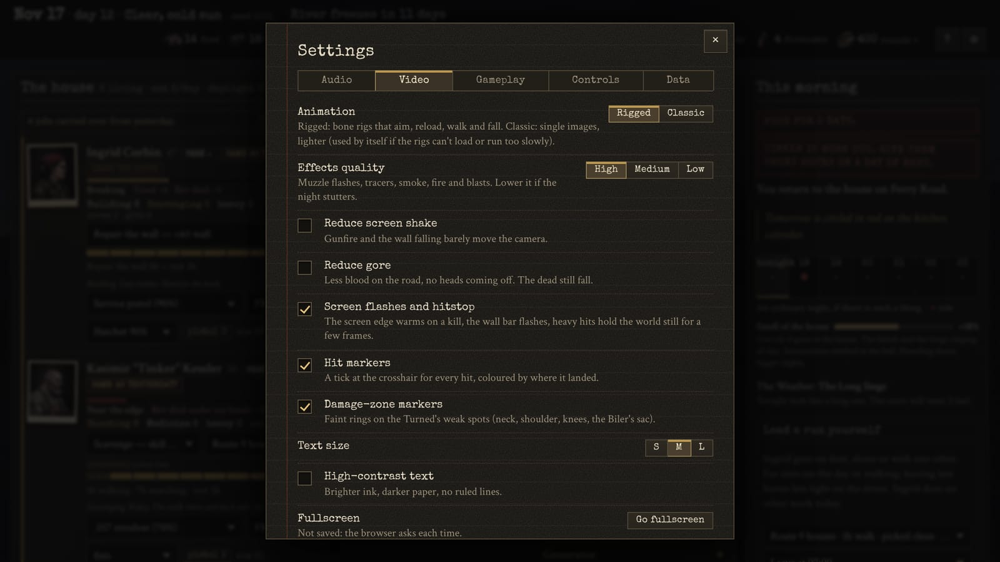 | 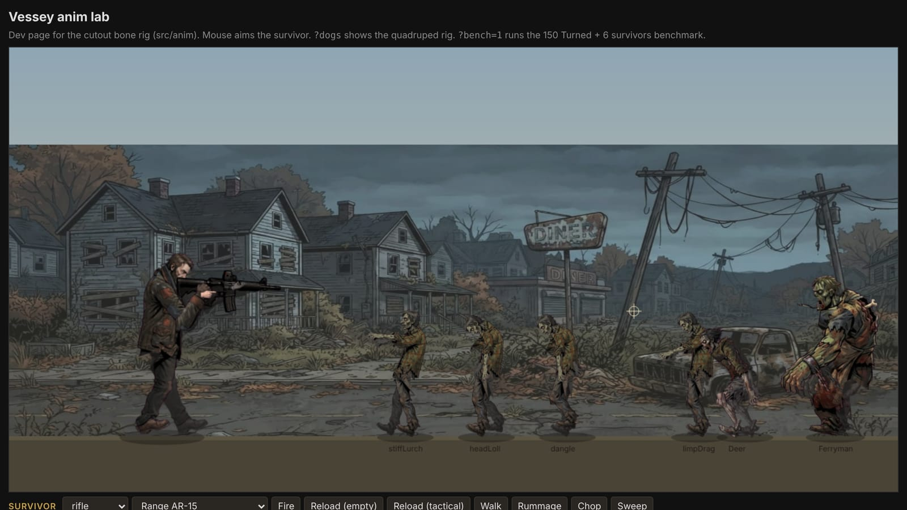 |
| **Settings.** Audio, video, gameplay, rebindable controls and save data, from anywhere. | **The anim lab** (`animlab.html`): every rig, gait, clip and death. |

## How to play
1. **Pick a Weather** on the title screen (or type a seed, or take the Daily Vessey).
2. **The day.** Give everyone one job and their hours: repair the wall, scavenge a site, work the bench (it does nothing without a pair of hands), grow food, tend the wounded, work the radio, drill, or rest. Queue ammunition and traps; build machinery. The leader can **lead a run** instead and play the daylight walk.
3. **Dusk.** The day's work resolves. Set posts, crew the gun nests and lay trap kits on the road.
4. **The night.** Hold the wall until dawn. The wall bar is the house's health: if it falls, they climb over. Aim for the head and for the glowing weak spots; noise draws stragglers; worn guns jam.
5. **Dawn.** Read what happened, then do it again until the ice comes on Nov 28. Get across, or get ready.

The **?** button (or `?` on the day screen) opens the house ledger: controls, the Turned, moods and breaks.

## Controls
All keys below are defaults; every one can be changed in **Settings › Controls** (conflicts are flagged, and the HUD follows your bindings).

| At the wall | | On a run | |
|---|---|---|---|
| Mouse / left click | aim / fire (hold for automatics) | Mouse / left click | aim / fire |
| Right click | Focus (hold, or toggle in Settings) | Right click / `V` | swing the hand weapon |
| Middle click / `F` | firebomb | `A` `D` / arrows | walk (home is the left edge) |
| `R` | reload, clear a jam (hold: speed reload) | hold `E` | search, revive the companion |
| `Q` / wheel | next gun | `R` | reload |
| `T` / `B` | ammunition / fire selector | `T` | ammunition |
| `S` / Ctrl (hold) | duck | `Space` | shove |
| `V` | hand weapon over the wall | `Tab` / `G` | pick / drop from the pack |
| `E` | rally (banked from a headshot streak) | `P` / `Esc` | pause |
| `M` | mark a target | | |
| `1`–`9` / `Tab` | select a guard | **The day** | |
| `Z` `X` `C` `K` | orders: free, hold, heads, wall (Shift: everyone) | `Enter` | go to the wall at dusk |
| `Y` | the selected guard's post | `?` | help |
| `L` / `G` / `H` | pull a lure / drop the deadfall or pipe mine / take the gun nest | | |
| hold `Space` | hurry the night along | | |
| `P` / `Esc` | pause menu | | |

## Settings
One ledger page, reachable from the title, the day screen (⚙) and the **pause menu** (`P`/`Esc` at night and on runs: Resume / Settings / Help / Quit to title; the game is frozen and takes no input while it is open). Everything is saved in this browser.
- **Audio:** master, music, effects and ambience volumes; mute.
- **Video:** animation Rigged / Classic, reduce screen shake, reduce gore, screen flashes and hitstop, hit markers, damage-zone markers, text size S/M/L, high-contrast text, fullscreen, frame-rate counter.
- **Gameplay:** realism Standard / Hardcore, reload when empty, Focus hold / toggle, the threat ribbon, show the tutorial hints again.
- **Controls:** every binding for the wall, runs and the day, with rebinding, conflict warnings and reset to defaults.
- **Data:** export the save (game, Ledger, settings, keys) to a file, import one, reset the Ledger, delete the saved game (both ask first).

## Dev
Everything is TypeScript: the game is Vite + strict TS (`src/`), and the tooling scripts (`tools/*.ts`) run through `tsx` and are typechecked by `tools/tsconfig.json`.
```
npm ci
npm run dev                                   # http://localhost:5173 (also /animlab.html, /soundboard.html)
npm run typecheck                             # strict TS for src/ and tools/
npm run build                                 # typecheck + vite build (game, anim lab, sound board)
npm run simtest -- 9                          # headless 30-day soak of the sim layer (+ economy check)
npx tsx tools/balance.ts --quick              # Monte-Carlo balance harness for the night fight (docs/balance.md)
npx tsx tools/ragdoll-check.ts                # 54 ragdoll deaths must come to rest lying flat
npx tsx tools/stage-save.ts 12 /tmp/vessey-save.json   # a believable day-12 save for testing
```
Browser checks (Playwright; run `npx vite build && npx vite preview --port 4192 &` first):
```
node tools/e2e/settings-check.cjs             # flips every setting and asserts what it changes; pause, rebinding, data
node tools/e2e/shots.cjs [scene…]             # the README screenshots (needs the staged save above)
```
Debug handles in the browser console: `__G` (the state), `__story` (`night(day)`, `run()`, `ending(kind)`, `roll()`, `crossing()`), `__battle`, `__EX` (the run), `__anim.state()`, `__settings`.

### Tools
- **Sprites** (`npm run sprites`, `tools/gen-sprites.ts`, `tools/sprites*.json`): generated with OpenRouter's cheapest image model on flat magenta, then chroma-keyed, trimmed and downscaled with `sharp` (about $0.03 each; the whole set cost under $2). Needs `OPENROUTER_API_KEY`.
- **Rig parts** (`tools/gen-parts.ts`, `tools/segment.ts`, `tools/rigs/`): a reference-guided "rig pose" image per character, cut into parts by nearest bone from the joints placed in `tools/rigs/<sprite>.json`. See [research 09](docs/research/09-animation.md).
- **Sound** (`tools/sfx-fetch.py`, `tools/sfx-build.py`): fetches CC0 packs from OpenGameArt (refuses anything that isn't CC0), trims, loudness-matches and encodes them to `public/sfx/`, and regenerates `src/audio/sample-manifest.ts` and `CREDITS.md`.
- **Balance** (`tools/balance.ts`), **sim soak** (`tools/simtest.ts`), **ragdoll check** (`tools/ragdoll-check.ts`), **staged save** (`tools/stage-save.ts`).
- **Pages:** `animlab.html` (every rig, gait, clip, death; `?bench=1` runs the 150-Turned benchmark) and `soundboard.html` (every procedural and recorded sound).

## Docs
- [Design document](docs/DESIGN.md) (with the roadmap) · [Balance](docs/balance.md)
- Research: [Last Stand & genre](docs/research/01-last-stand-and-genre.md) · [RimWorld & emergent story](docs/research/02-rimworld-emergent-story.md) · [Art style & lore](docs/research/03-art-style-and-lore.md) · [Depth & readability](docs/research/04-depth-and-readability.md) · [Combat depth](docs/research/05-combat-depth.md) · [Design principles & loops](docs/research/06-design-principles-and-loops.md) · [Gun audio](docs/research/07-gun-audio.md) · [Traps](docs/research/08-traps.md) · [Animation](docs/research/09-animation.md)

## Credits
Code, procedural audio and the story are original to this project; the art is AI-generated for it. Recorded sound effects are **CC0 / public domain** from OpenGameArt, listed with authors in [CREDITS.md](CREDITS.md) ([what CC0 means](https://creativecommons.org/publicdomain/zero/1.0/)). Fonts: Special Elite and Crimson Text (SIL Open Font License, via Google Fonts).
