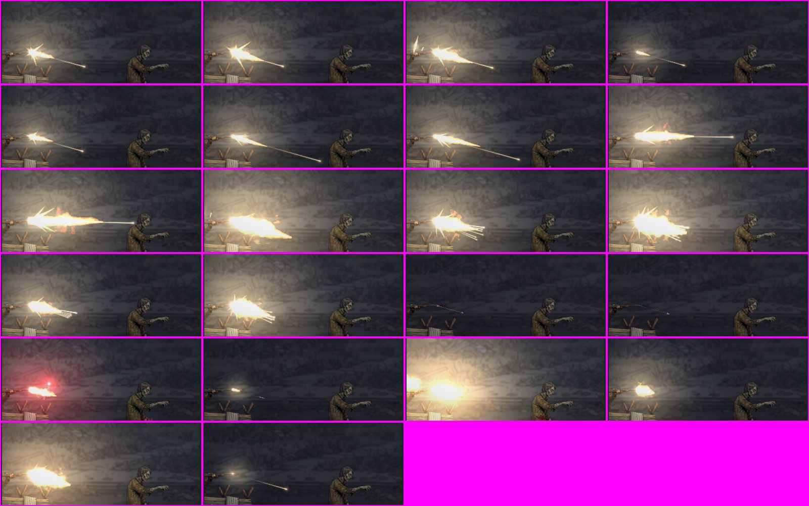
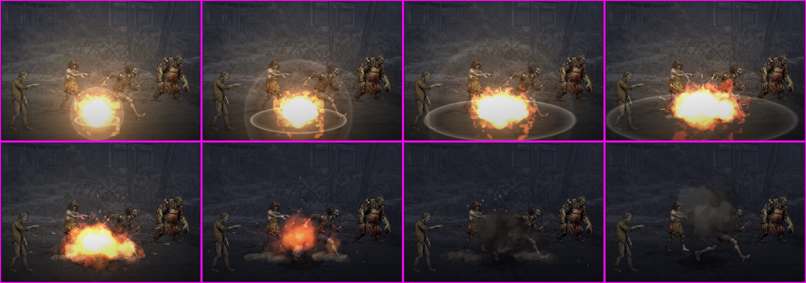
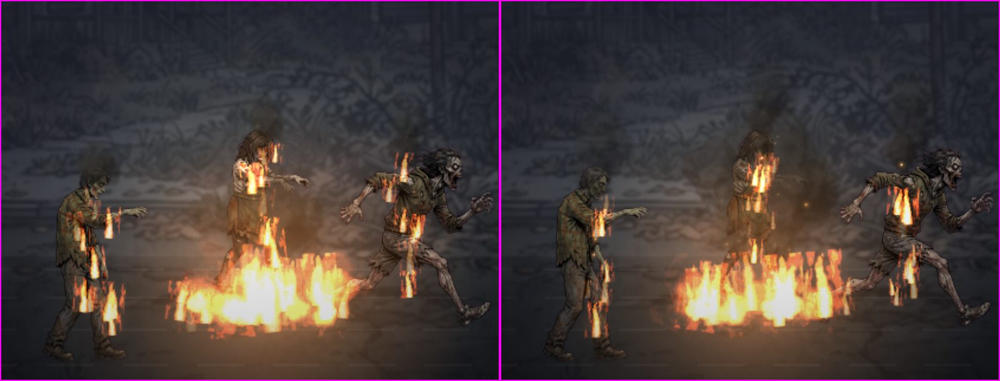
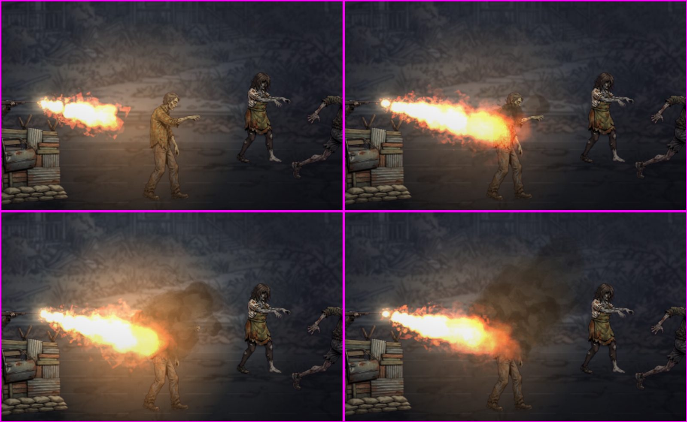
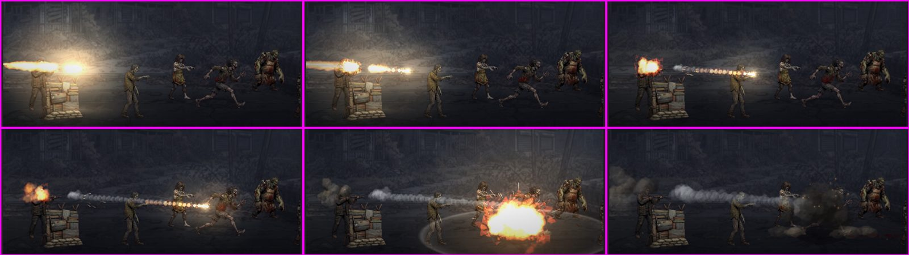
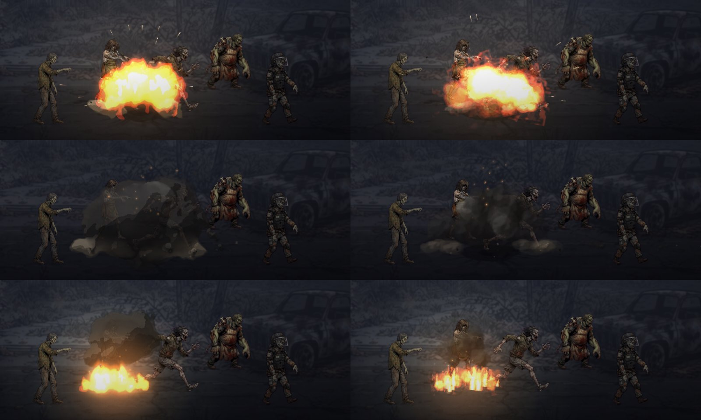

# 10 — Gunfire & special effects

Status: shipped in `src/night/vfx/` (system) and `src/night/gunfx.ts` (feel numbers), hooked into the night
(`battle.ts`, `emplacements.ts`) and the daylight run (`expedition.ts`). Dev page: `fxlab.html`
(`npm run dev`, then `/fxlab.html`). Settings → Video → **Effects quality: High / Medium / Low**; High adds the
WebGL2 layer (§6) where available.

The brief was: *"why are bullets just lines — really realistic muzzle flash, bullet trails with velocity, AAA."*
Before this pass a shot was a 1.6 px line for 0.07 s plus one of five flat flash shapes; impacts were
coloured squares.

*First frame of every gun class in fxlab (row by row): service pistol, 1911, .357 revolver (note the
cylinder-gap jet behind the muzzle), farm .22, SMG / AR-15, LMG, bolt rifle, scoped .308 / muzzleloader,
pump, coach gun (both barrels), .410 / pipe shotgun, compound bow, crossbow / flare pistol, nail driver,
M72 (backblast), M79 / dragon's breath, suppressed pistol.*

## 1. References

### The user's own repositories (cloned under `/home/user/cktang88`, `/home/user`)

| Repo | What we took |
|---|---|
| **siege-game** `src/fx.ts`, `render.ts`, `decals.ts`, `game.ts` | The closest match (2D side view, cel art). *Fire as a temperature ramp with hard bands* (pale core → yellow → orange → red → deep-red rim) instead of soft blobs; *smoke cel-shaded from its own density gradient*, lit top-left, with a darker silhouette band and two opacity steps (after McGuire et al., "Real-Time Cartoon Rendering of Smoke"); *velocity-stretched sparks* (`len = s + speed·0.022`); smoke/flame at **half resolution** (we do the same for smoke, §5); `room` throttle so continuous emitters thin as the pool fills; `fxExplosion` ordering (flash + ring → fireball that brakes and cools → sparks → smoke takes over, column rising); `muzzleBlast` (light + forward fire puffs + smoke); "every bright thing is a light" (`LightPool`) — our muzzle, tracer, rocket, flare and fire lights all go to the battle's darkness mask; effects-quality = pool caps + field resolution. |
| **autobattler-2** `src/client/render/vfx.ts`, `fx.ts` | Canvas2D practice: *cached procedural sprites, never per-frame gradients / shadowBlur / filters*; bloom = bright centre + long tail glow; turbulent fireball lobes per temperature stage; lumpy lit puffs; directional cone flash; shock ring with a bright leading edge; effects *front-loaded* (max size and brightness in the first frames, fast ease-out); scorch appears *after* the flash clears; normal pass (dust, smoke, debris) then additive pass; debris trails smoke wisps; ground shock rings only for big blasts ("small ones looked like glassy discs" — we hit exactly that and toned ours down); photosensitivity cap on full-screen flashes. |
| **3d-fps** `src/render/Effects.js`, `ProcTex.js`, `Ballistics.js`, `world/ambience/DistantBattle.js`, `docs/QUALITY_BAR.md`, `RECOIL_RESEARCH.md` | Per-surface impact table (puff count/colour/size/gravity, chip count, sparks only on metal and 30% on concrete) → our `doImpact` surfaces; a tiny hot flash on hard surfaces "sells the hit"; tracers as velocity-stretched additive quads sliding along the path at a capped speed; **"only every 4th round is a tracer"** (DistantBattle); procedural muzzle atlas (prongs + radial core); fixed-size light pool; the quality bar ("every frame should read like key art"). |
| **voxel-castle-defense** `src/particles.ts` | Additive glow pool vs soft smoke pool vs chunky bits that land and *stay as splats* — our blood, chunks and brass stamp into the ground canvas when they land. |
| **heist-sandbox** `hazards/grenades.ts`, `ui/weather.ts` | Bounce/roll damping for thrown things (our casings: two bounces at 25–40% then a decal), the lightning-flash-as-one-opacity idea (our scene wash is one additive quad, not a full-screen fill per light). |
| **macro-rts** `src/view.js`, `sim/core.js` | Effects as short-lived sim records (`tracer`, `blast`) drawn by the view — the shape of our `Round` / `Pend` records; expanding blast ring. |
| **3d-world-objects** `src/lighting.ts` | Colour-temperature thinking for lights (warm muzzle 255,196,120; flare 255,90,80; fire 255,140,60; steel-spark 255,220,160). |
| **3d-turret-demo**, **minion-shooter-game**, **card-game**, **fastrender**, **history-effects** | Skimmed: turret/projectile sims and a GPU renderer — confirmed the "visible projectile at a fraction of real speed" approach and SoA/instancing for perf; no 2D gunfire VFX to borrow beyond that. |

### Research

- **Muzzle-flash anatomy** ([Wikipedia: Muzzle flash](https://en.wikipedia.org/wiki/Muzzle_flash); [navweaps tech-090](https://navweaps.com/index_tech/tech-090.php)):
  a small white-hot **primary** flash at the crown; a reddish **intermediate** disc a few inches out where the
  gas meets its own shock (the Mach disc); the large yellow/white **secondary** flash where fuel-rich gas mixes
  with air and burns — most of the visible energy; **muzzle glow**; **sparks** of unburnt powder. Flash hiders
  break the plume into prongs and suppress the secondary flash; suppressors leave a puff.
- **Tracers**: belts are usually linked "four-to-one", i.e. one tracer in five ([Wikipedia: Tracer
  ammunition](https://www.wikipedia.org/wiki/Tracer_round); [.50 BMG 4:1 belt](https://velocityammosales.com/?p=2149)).
  The brief asked for every 4th on the LMG; we use 1-in-4 for the LMG (it reads better at our fire rates) and
  1-in-5 on the Guard carbine's magazines; civilian guns carry no tracers.
- **Game feel**: Vlambeer's "The Art of Screenshake" (Jan Willem Nijman, INDIGO 2013 —
  [video](https://youtu.be/AJdEqssNZ-U), [summary](https://gamedeveloper.com/design/vlambeer-co-founder-shares-advice-on-building-better-action-games)):
  bigger bullets, muzzle flash, impact effects, *smoke for permanence*, shells that stay; Nuclear Throne's
  pistol: camera kicked 6 px, shake +4. Our shake/kick numbers already live in `gunfx.gunFeel` (balance.md §5);
  this pass adds the visual half. Also "Juice it or lose it" (Jonasson & Purho) and the
  [realtimevfx.com muzzle-flash thread](https://realtimevfx.com/t/wondering-how-good-muzzle-flashes-are-made/13540/10)
  (flipbook of a few hand-shaped frames + light + sparks + smoke; never the same frame twice).
- **Reference games** (looked at for read, not copied): Broforce / Metal Slug (chunky cartoon explosions, smoke
  as drawn puffs), Enter the Gungeon / Nuclear Throne (oversized flashes, every bullet visible), Hotline Miami 2,
  Katana Zero (one-frame white flashes), Intravenous (dark scenes cut by muzzle light — the closest to our
  darkness layer), Teleglitch, Dead Cells / Blasphemous (additive glows over hand-drawn art), Insurgency /
  Squad footage for real flash shapes (bolt rifles: long plume + secondary fireball; ARs: small birdcage star).

## 2. Design

Everything is **procedural** (§4) — no image API was needed (the OpenRouter budget went unused).

### 2.1 A shot, frame by frame

1. **Frame 0** — `vfx.muzzle()`: the flash instance (2–6 frames, `FlashSpec.life`), a light into the battle's
   darkness mask (radius per gun, warm 255,196,120; flare red; dragon's breath orange), a one-frame **scene
   wash** for the big guns (a 1000 px warm additive quad, off under *Screen flashes* off), powder sparks, smoke
   puffs that are driven forward and brake hard (drag 3.2/s) then rise and drift with the wind, brass out of the
   port.
2. **Frames 0–4** — `vfx.bullet()`: the round travels at a visual speed (pistol 5,200 px/s, rifle 9,500, LMG
   8,600, buckshot ~4,200, nails 2,600, arrows 2,300, flare 1,100) and is drawn as a **motion-blur streak**
   whose length is the distance covered in one frame (`speed × 0.014 s`, tracers `× 0.026`): hot white core over
   a tinted glow, a head glow, gone in a frame or two after it arrives. Tracers are thicker, red-orange, with a
   brighter head and a 70 ms afterglow.
3. **Arrival** — impacts reported by the hitscan (`damage()` → `vfx.impact()`) are **queued between
   `shotStart()` and `bullet()`** and released when the visible round gets there (`distance / speed`), so blood
   never appears before the bullet. A miss onto the road spawns its own impact at arrival.

The game logic is still hitscan and unchanged; only the picture is delayed by 1–4 frames.

### 2.2 Per weapon class (`vfx/looks.ts`)

| Class | Flash (FlashSpec) | Round |
|---|---|---|
| Pistols (service, 1911, MP93) | star burst + 2 petals + short plume, Mach disc; 1911 a touch bigger with a small secondary ball | 5k px/s streak, brass |
| .357 revolver | bigger plume + secondary ball + **cylinder-gap jets** (vertical petals and sparks 22 px behind the muzzle) | streak, no brass (wheel gun) |
| Farm .22 | tiny plume, tiny puff, small light | thin streak |
| SMG | small star, 45 ms flash (strobes at full auto) | streak, brass |
| AR-15 / carbine | thin plume + 4 **birdcage prongs** at ±0.32 rad, no secondary flash | 9k px/s; carbine tracer 1-in-5 |
| LMG | longer plume, 4 prongs, Mach disc | **tracer every 4th**, links + brass, barrel smoke as it heats |
| Bolt / lever / scoped | long plume + **secondary fireball** + big bloom + scene wash, 3 smoke puffs | 9.5–10.5k px/s streak |
| Shotguns | wide plume (34 px), 4 wide petals, secondary fireball, powder sparks, smoke | **fan of short pellet streaks** (9 per shell, each its own speed jitter); slugs a heavier single streak |
| Coach gun | everything ×1.35, **twin plumes** (both barrels), 16 sparks, 7 smoke puffs, 0.1 wash | pellets |
| .410 / pipe gun | small / dirty (22 sparks, dark smoke) | pellets |
| Muzzleloader | 84 px plume, 46 px fireball, 28 burning-powder sparks, lock-pan jet, **18 dense white black-powder puffs that hang 4–6 s** | slow 3.6k px/s ball |
| Suppressed (any) | no plume, 4 px core, a grey gas puff, light ×0.3 | no tracer |
| Bow / crossbow | none | **arrow / bolt sprite in flight** (shaft, fletching, broadhead), sticks in the road at an angle for 8 s on a miss; fire bolts carry a flame and drop embers |
| Nailer / rivet gun | tiny puff and spark | nail / rivet sprite with a faint glint streak |
| Flare pistol | red plume and bloom, red light | **glowing red ball on an arc** trailing pink smoke and sparks; lands and **burns on the road 9 s** (sparks, smoke, flicker; the battle's flare light lights the road) |
| M72 rocket | front plume + fireball, **backblast** (fire and a dust cloud out of the back, light behind the shooter) | rocket sprite + motor glow + a continuous smoke ribbon; the blast **waits for the rocket to arrive** |
| M79 / pipe mortar | small "thoomp" flash and puff | the battle's lob arc: the grenade (or capped pipe with a spitting fuse) spins and trails smoke |
| Dragon's breath | big orange flash + **flame cone** of 34 burning particles | burning pellet streaks shedding embers |
| Flame projector (emplacement) | — | a stream of 110 fire particles/s with a white-hot liquid core at the nozzle, billowing up, dark smoke on top, flickering light |

### 2.3 Impacts by surface (`doImpact`)

| Surface | Look |
|---|---|
| **Flesh** | dark blood **mist** blown out the far side (cel puffs, deep red), an **exit spray** of droplets forward (78%) and a little back-spatter out of the entry, droplets stretched along their velocity (teardrop sprite), chunks on big hits; droplets that land **stamp splats** on the road at the lane's ground row. |
| **Head** | ×1.6, bone-white chips; a head that comes off (`gib`) adds a burst of chunks. |
| **Reduce gore** | a third of the droplets, smaller and nearly black, no chunks, no gibs. |
| **Armour** (Deputy plate) / metal | a white pop, 12 sparks thrown back off the plate with gravity and a bounce, a **ricochet streak** 40% of the time, a small light. |
| **Wood** (the barricade, raiders' misses) | splinters (thin rotated slivers, gravity, bounce), a tan dust puff, a **bullet-hole decal on the barricade** (ring buffer of 70). |
| **Road** | a dust puff that lifts and drifts with the wind, dark chips, grit sparks 30% of the time, a chip mark stamped into the road. |
| **Snow** (snow weather, the Crossing) | white powder puffs and snow chips instead. |

### 2.4 Explosions (`explosion()`), fire (`burn` / `burnBody`), decals

Explosion, in order (siege-game/autobattler ordering): white pop + orange glow + a 520 px light + scene wash →
a ground-plane **shock ring** racing out (squashed to the road's perspective) and an air ring with a dark
**refraction band** (fake distortion) → a white-hot core and 6–22 fireball lobes thrown out, braked, rising and
cooling through the temperature stages, a second rolling wave at 70 ms → sparks with gravity and a bounce,
embers that drift on the wind, debris that trails smoke and bounces → a dust skirt along the road → a dark smoke
column (delayed 0.1–0.35 s) that hangs 3–5 s and drifts → the **scorch decal** stamped as the fireball clears
(120 ms). Every dying fire particle has a 55% chance to leave a smoke puff behind (fire turns to smoke).

*fxlab, frames 1, 3, 6, 10, 18, 30, 60, 150 (60 fps).*

Fire pools (molotovs, burning fuel): a burning **bed** of low fireball lumps, **flame tongues** (metaballs up a
wavering spine, licked-off tips, detached wisps; tall in the middle, short at the edges; mirrored at random),
embers, a dark smoke column, a hot glow smeared on the road + a soft column of light, and a **flickering** light
(new short lights at 9/s, so the darkness gutters). Burning bodies get tongues over their height and a wisp.

 

Decals go into the battle's persistent ground canvas (`gctx`, under the darkness): blood splats, brass and
hulls (rotated, where they stopped), chunk stains, road chips, scorch. The barricade's bullet holes are drawn
right after the wall in the y-sorted list.

### 2.5 Integration with lighting and depth

- **Darkness**: every bright thing pushes a light through `host.light()` → `battle.lights` → the darkness
  mask's holes and the glow pass (muzzle flashes per gun, tracers' heads, rockets, flares in flight and on the
  road, steel sparks, explosions, fire flicker). A flash also lays a flattened warm pool on the road under the
  gun.
- **Layering**: `drawNormal` (smoke, blood, debris, brass, arrows, rockets) right after the y-sorted actors and
  before darkness pass B, so it sits *in* the night; `drawAdd` (flashes, tracers, sparks, fire, glows) after
  darkness pass B and before the vignette — **emissive things are not darkened**.
- **Depth lanes**: impact, round and fire sizes scale by `laneScale(laneY)` (= render.ts `depthScale`); flashes
  by the shooter's `g.sc`; droplets, sparks and debris land on *their lane's* ground row.
- **Settings**: Reduce gore (above); Reduce shake untouched (shake stays in battle); *Screen flashes off* also
  removes the scene wash; **Effects quality** (new): High = 2,000 particles, full counts, full bloom; Medium =
  1,100, ×0.6 counts, bloom ×0.7, smoke layer at 0.4 res; Low = 450, ×0.32 counts, no soft bloom / wash /
  shock band / fire light-column, fire unrotated.
- **Simulation**: effects never touch the game's seeded `R` (Math.random only), so they can't change a night.

## 3. Hooks (the whole integration)

`battle.ts`: construct `this.vfx`; `update` → `vfx.update`, fire pools → `vfx.burn`; `roundFired` → `vfx.muzzle`
(replaces the light, smoke, wisp and casing pushes); `castShot` → `vfx.shotStart` + `vfx.bullet` (replaces the
tracers and the miss dust/sparks); `damage` → `vfx.impact` (armour / flesh / head) and `vfx.gib`; `blood()` →
`vfx.impact('flesh')`; burning bodies → `vfx.burnBody`; `raiderFire` → muzzle / bullet / wood impact; `blast` →
`vfx.explosion` (replaces light, particles and the scorch); molotov → `vfx.throwArc`; the yard nail turret → `vfx.muzzle`; draw: the guard's flash
call removed, `vfx.drawWall` after the wall, `vfx.drawLob` for grenades, `vfx.drawNormal`, `vfx.drawAdd`.
`emplacements.ts`: `vfx.muzzle` in `shoot` (MG nest, swivel gun, nail turret), `vfx.flame` in the flame
projector. `expedition.ts`: the same four calls in world space under the run's camera. `settings.ts`: the
`fxQuality` setting and its getter. Traps' `b.blast(...)` calls get the new explosion for free.

## 4. Textures (`vfx/sprites.ts`)

Generated once at startup into offscreen canvases (~70–120 ms CPU; `vfx.S.ms` reports it), mostly
per-pixel with value noise / fbm:

- glows (10 tints, 64²) — bright centre, long tail;
- fire blobs (4 temperature stages × 4 variants, 96²) — lumpy metaballs, hard bands;
- flame tongues (6, 48×96) — metaballs up a wavering spine, banded, core only low in the flame;
- cel-shaded puffs (9 tints × 4, 96²) — lit/mid/shadow from the density gradient, a darker rim band, two
  opacity steps;
- plumes (6, 200×64) — the forward flame, spindle with lumps, banded white → yellow → orange;
- petals (4), star bursts (4), streaks (6 tints: warm, tracer, pale, fire, flare, bile), shock ring + refraction
  band;
- small solids: brass / hull / link / steel casings, arrow, bolt, nail, rivet, rocket, grenade, pipe bomb,
  bottle, blood droplet ×2, flesh gibs ×3, bone ×2;
- decals: scorch ×3, barricade bullet hole ×4, blood splat ×6 (+3 dark for Reduce gore), road chip ×3.

## 5. Budget and performance

- **Pool** (`vfx/pool.ts`): structure-of-arrays (`Float32Array` × 17, `Uint8Array` × 4), cap 2,000 (quality),
  swap-remove, no per-particle objects or closures; when full, a new particle overwrites an old *optional* one
  (smoke, dust, mist, embers) round-robin; continuous emitters read `room` and thin themselves. Flashes (48),
  rounds (256) and pending impacts (128) are fixed pools of reused objects.
- **Drawing**: one pass per blend mode; every blit is `setTransform` (composed by hand with the caller's
  transform, no save/restore) + `drawImage` of a cached sprite; `fillStyle` set only when it changes.
- **Smoke at half resolution**: smoke, dust and blood mist — big, soft and many — are drawn **unrotated** into a
  half-resolution layer (0.4 on Medium/Low) with a dirty rectangle (only last frame's rect is cleared, only this
  frame's rect is blitted), then stretched over the scene in one `drawImage`. On the CPU rasteriser this was the
  single biggest win (the A/B below).

Measured in this container (**no GPU: Chromium software raster**, Playwright, 1280×720):

| Scene | fps (rAF frames / s) |
|---|---|
| fxlab heavy scene — LMG held (≈12 rps, tracers), a 9-pellet shotgun every 0.5 s, a 150 px blast every 1.5 s, a fire pool — **no effects** | 60 |
| same, **High** (≈530–580 live particles) | 43 (was 25 before the smoke layer; 29 before quality-scaled bloom) |
| same, **Medium** (≈400) | 49 |
| same, **Low** (≈270) | 56 |
| A/B on High before the smoke layer: everything / no normal pass / no additive pass / neither | 25 / 54 / 31 / 59 → the normal pass (smoke fill) was the cost |
| the real night (night 8, rigs, darkness, 100+ Turned), stress script: LMG held + guard shotgun every 0.5 s + blast every 1.2 s + fire — **effects calls stubbed out** | 22.7 |
| same, High / Medium / Low | 18.2 / 19.4 / 20.7 |

JS-side cost of the effects system alone (update + record draw calls) is 0.1–0.4 ms in an ordinary fight and
≈1–3.5 ms in the stress scene; the rest is raster fill. The game itself already runs at ~30 fps idle in this
GPU-less container, so absolute numbers are pessimistic; on a GPU-composited Canvas2D the additive glows and the
smoke layer are cheap and High is the default.

## 6. WebGL2 layer (`vfx/gl.ts`)

Shipped as an optional layer over the Canvas2D system, on at **Effects quality High** (no new "Ultra" tier: the
setting lives in `src/ui/settings.ts`, owned elsewhere; adding a tier there is a three-line follow-up). The
Canvas2D paths of §2–§5 remain the fallback and are unchanged.

**Shape.** One offscreen WebGL2 canvas, shared by every `Vfx` (a new night does not make a new context; browsers
cap them), sized to the 2D canvas. It never owns the composite: `drawNormal` and `drawAdd` still run at the same
two points in the battle's layer order and `drawImage` the GL canvas back into the 2D context.

- **Fields, at `drawNormal`** (after siege-game `src/fx.ts`). `gather()` walks the SoA pool once and writes
  smoke / dust / mist and fire / flame-tongue particles into two preallocated `Float32Array` instance buffers
  (12 floats each, no per-particle objects), uploaded with one `bufferSubData` each. Each instance splats a
  noise-lumped blob additively into a **half-resolution** field (RGBA16F when `EXT_color_buffer_float` is there,
  else RGBA8): smoke writes premultiplied tone + density, fire writes heat (opacity × a temperature that drops
  through the four stages as it ages; tongues are teardrops whose tips lean). The smoke field is then
  **thresholded and cel-shaded** in one full-screen pass — two tones and a dark rim from the density gradient
  (lit top-left), two opacity steps (wisps 0.5, body 0.88), noise-eroded edges as it thins, an orange under-glow
  where it sits over heat — and drawn back source-over (premultiplied). Many puffs read as one cloud with one
  outline instead of a pile of discs.
- **Heat haze / shockwave refraction, at `drawAdd`** (before the additive light). Up to 16 sources a frame,
  gathered in canvas px: shock rings (a lens ring at the ring's radius that pushes out on its leading edge and in
  behind it, ±12% brightness at the crest), muzzle blasts of the big guns for 90 ms (radial puff), fire pools,
  burning flares and big fireballs (a rising, wavering column above them). Only when at least one is live, the 2D
  canvas is uploaded **once** (`texImage2D` of the canvas) and the displaced scene is drawn back inside the
  sources' scissor box; outside the distortion the shader discards. The fake dark "refraction band" sprite of
  the shock ring is skipped while real haze is on.
- **The additive pass.** Nothing about what is drawn changed: the same `drawAdd` code runs, but its `rot()` blit
  helper feeds an **instanced sprite batch** (origin + two axes + atlas rect + alpha, 12 floats) instead of
  `drawImage`. All procedural sprites (§4) are shelf-packed once into a 2048-wide atlas (premultiplied, 2 px
  gutters, half-texel inset). Fire and flame-tongue particles skip their sprite and come from the **heat field**,
  thresholded into the **banded ramp** (deep-red rim → red → orange → yellow → pale core, `fwidth`-antialiased
  band edges, licks from upward-scrolling fbm sheared by the wind), so merged fire has one hard toon outline.
  Everything lands in an RGBA16F target (ONE, ONE blending ≈ `'lighter'`).
- **Bloom.** Bright pass (soft knee on the max channel) while downsampling to quarter resolution with 4 bilinear
  taps, then a separable 5-tap Gaussian folded into **3 linear taps**, two H+V iterations, added at 0.7 × the
  quality's glow factor. The final blit writes alpha = the brightest channel, so the GL canvas is valid
  premultiplied data and `'lighter'` adds exactly its colour.

**Fallback and switches.** Canvas2D whenever `getContext('webgl2')` fails or a shader does not compile, after
`webglcontextlost` (the restore handler rebuilds programs, targets and atlas; tested with `WEBGL_lose_context`),
at Effects quality Medium / Low, with `?gl=0` in the URL, or with `vfx.glWanted = false` (fxlab's toggle).
`vfx.path` says which path drew the last frame.

**Governor.** `govern()` runs once a frame from `drawAdd` while GL draws: it averages the frame interval over 2 s
windows (intervals over 1 s — a hidden tab — are ignored); two windows in a row over budget (default 22 ms,
≈45 fps) step the layer down one level — **bloom off → haze off → GL off** — each step logged once via
`console.info('[vfx] …')`. It never steps back up within the session (a new tab does). `G.setLevel(l, pin)` pins
a level (fxlab, tests).

**fxlab.** A *GL: on/off* button (or **G**) flips between the two paths on the same live scene; *governor* pins
full GL; a second readout line shows fps, which path drew, the GL level, sprite / smoke-blob / heat-blob / haze
counts, the number of scene uploads and the CPU ms of the GL work. `__fx.gl(on, level)` drives it from tests.

*fxlab, GL (left) vs Canvas2D (right), same seed: a blast at frame 18 (the heat field merges the lobes into one
banded fireball with a single rim), the same blast at frame 60 (the smoke field as one cel-shaded cloud: lit
top-left, shadow, dark rim, two opacity steps), a fire pool (the GL tongues merge into a banded bed; the Canvas2D
tongue sprites still read as taller, separate flames — the heat blobs of tongues could be stretched further).*

**Performance — not measured honestly here.** This container has no GPU: Chromium runs WebGL on SwiftShader
(CPU) and the 2D canvas is software, so every `drawImage` of the GL canvas is a GPU→CPU readback (Chromium logs
"GPU stall due to ReadPixels"). In fxlab's heavy scene that makes GL **≈ 3 fps vs 43 fps** for Canvas2D, and
the governor duly walks GL off within ~12 s, in the night as well as in fxlab (which also exercises the
fallback in `tools/e2e/smoke.cjs`). On a real GPU with an accelerated 2D canvas the three blits per frame are
texture copies and the fields are a few hundred instanced quads at half resolution; this is expected to be cheap
but has **not** been measured — check the fxlab readout on real hardware before making it the default for
everyone; the governor is the safety net meanwhile. The JS cost is one pool walk plus the batch writes (the
existing draw code minus the `drawImage` calls).

## 7. Verification

- GL layer: `npx tsc --noEmit`, `npm run build`, `tools/e2e/smoke.cjs` against `vite preview` clean (GL on at
  the default High; the governor steps it off on SwiftShader mid-run, so both paths run). Playwright: fxlab GL vs
  Canvas2D for blast / smoke / fire / LMG / shotgun / rifle / flamer / burning bodies, pixel diffs confirming bloom
  and haze each change the frame, `WEBGL_lose_context` lose → Canvas2D → restore → GL, Medium → Canvas2D, a
  staged night moment GL vs Canvas2D, the governor's three logged steps; no page errors, no non-finite particle
  fields.

- `npx tsc --noEmit && npm run build && npm run simtest -- 3` pass; `tools/e2e/settings-check.cjs` passes
  (new check: Effects quality changes the particle budget the night uses).
- fxlab frame sequences at deviceScaleFactor 2 for every gun, each surface, explosion, fire pool, burning
  bodies, flame projector, rocket, flare, M79, gib, snow, unlit and floodlit; the real night stepped frame by
  frame with the battle paused (`update(1/60)` + `draw()` by hand, canvas read back) for shotgun, LMG (tracers),
  M72 and M79, unlit and with three floodlights; the daylight run fired with no page errors.

## 8. Not done / next

- An "Ultra" effects tier in Settings for the GL layer (it rides on High today), and a governor that steps
  back up; GL perf on real GPUs (§6).
- Rain interaction (the game has snow, not rain): falling flakes are not yet lit by flashes.
- Barricade bullet holes only from raider fire (the leader's rounds go out over the road); casings in the
  daylight run vanish when they land (no ground decal canvas there).
- Muzzle flashes of the emplacements still also draw their own small shape in `emplacements.ts` (owned by
  another agent); the vfx flash is drawn on top.
